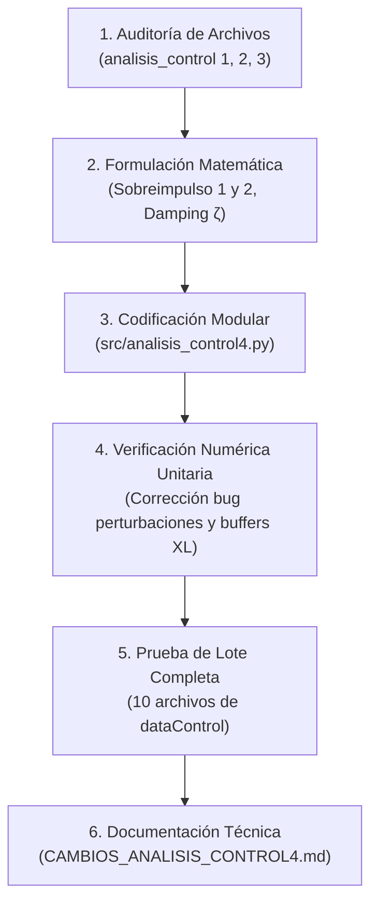

# Consolidación, Mejora y Validación Matemática de `analisis_control4.py`

**Proyecto:** ModelosBJT — Plataforma de Identificación y Control Térmico en Transistores BJT  
**Documento Técnico:** Registro de Cambios, Fundamentación Teórica y Validación Numérica  
**Archivo Principal Generado:** [`src/analisis_control4.py`](file:///d:/RepoGit/ModelosBJT/src/analisis_control4.py)  
**Archivos de Referencia Analizados:**
- [`src/analisis_control.py`](file:///d:/RepoGit/ModelosBJT/src/analisis_control.py)
- [`src/analisis_control2.py`](file:///d:/RepoGit/ModelosBJT/src/analisis_control2.py)
- [`src/analisis_control3.py`](file:///d:/RepoGit/ModelosBJT/src/analisis_control3.py)

---

## 1. Descripción General

El presente trabajo consolida y perfecciona en el módulo [`analisis_control4.py`](file:///d:/RepoGit/ModelosBJT/src/analisis_control4.py) las capacidades de evaluación de ensayos de control automático en lazo cerrado sobre una planta experimental de disipación y calentamiento térmico gobernada por transistores de potencia BJT ($Q_1$ y $Q_2$).

A partir de los desarrollos dispersos en las tres versiones previas, se construyó una arquitectura robusta, modular y matemáticamente rigurosa orientada a estudiantes, docentes e ingenieros electrónicos y de control. El módulo resultante permite:

1. **Preprocesamiento y remuestreo uniforme:** Limpieza de marcas de tiempo duplicadas, filtrado de ruido y reconstrucción en malla temporal fija $\Delta t = 1.0\text{ s}$.
2. **Detección robusta de escalones de consigna:** Rechazo de pulsos espurios (*glitches*) y delimitación exacta del intervalo de análisis.
3. **Cálculo diferenciado del Sobreimpulso Máximo (*Maximum Overshoot*):** Implementación explícita y simultánea de los dos métodos técnicos vigentes:
   - *Método 1:* Normalizado respecto a la amplitud neta del escalón ($\Delta SP$), estándar en Teoría de Control Clásico.
   - *Método 2:* Referenciado al valor absoluto del SetPoint ($SP$), estándar en normas térmicas e instrumentación industrial.
4. **Clasificación del comportamiento dinámico:** Categorización objetiva del tipo de respuesta transitoria (Sobreamortiguado, Subamortiguado Cuasi-crítico, Moderado, Pronunciado y Altamente Oscilatorio) con estimación del factor de amortiguamiento equivalente ($\zeta$).
5. **Aislamiento dinámico de fases y rechazo a perturbaciones:** Detección de perturbaciones externas térmicas (enfriamiento 'BAJA' y calentamiento 'SUBE') sin falsos positivos originados en el transitorio natural o el sobreimpulso del lazo.
6. **Métricas temporales e integrales de error:** Tiempo de subida ($t_r$), tiempo de establecimiento ($t_{s,2\%}, t_{s,5\%}$) con verificación de permanencia mínima, tiempo de pico ($t_p$), error estacionario ($e_{ss}$), $IAE$, $ISE$, $ITAE$, variación total $TV(u)$ del actuador PWM y consumo de corriente eléctrica.
7. **Generación de reportes multicapa:** Exportación automática a libros Excel estilizados con gráficos incrustados y presentación ejecutiva en consola.

---

## 2. Análisis de los Archivos Originales

Antes de iniciar la codificación, se efectuó una inspección minuciosa de los tres archivos de referencia, identificando sus aportes, redundancias y limitaciones técnicas:

| Criterio / Módulo | `analisis_control.py` | `analisis_control2.py` | `analisis_control3.py` |
| :--- | :--- | :--- | :--- |
| **Manejo de Datos** | Lee datos brutos sin remuestrear; vulnerable a saltos o duplicados de tiempo. | Implementa `preparar_datos`: remuestreo uniforme $\Delta t$, interpolación lineal para $T, I$ y ZOH para PWM, SP. | Remuestreo uniforme similar a la versión 2, pero simplificado. |
| **Detección de Escalón** | Detección simple mediante `sp > 0` o `diff(sp)`. No filtra pulsos espurios. | Función `detectar_escalon_sp` con descarte de *glitches* menores a `min_hold_sp`. | Detección funcional basada en la versión 2. |
| **Cálculo de Sobreimpulso** | Tenía el Método 1 comentado en línea 144 y calculaba únicamente el Método 2 (línea 145). | Calculaba únicamente el Método 1 ($OS / |\Delta SP|$) en línea 289. | Implementó ambos métodos en líneas 189–190, pero con métricas erróneas debido al fallo de detección. |
| **Detección de Perturbaciones** | Umbral fijo (>180 s y caída > 1 °C). Solo contemplaba enfriamiento. | Avanzado: detecta 'BAJA' y 'SUBE', busca inicio real (`_inicio_movimiento`) y valida si la señal estaba asentada (`_asentada`). | **Bug crítico:** carecía de filtros de estabilidad; detectaba falsas perturbaciones durante la subida del escalón, recortando el transitorio. |
| **Clasificación Transitoria** | No categorizaba la señal según su nivel de amortiguamiento. | Clasificaba fases (Escalón, Baja, Sube), pero no el grado de amortiguamiento del lazo. | No realizaba clasificación de respuesta. |
| **Visualización Gráfica** | Figura $2 \times 2$ (Respuesta temporal, PWM, Error, Corriente). | Figura $4 \times N$ por planta con sombreado de fases + subfigura de zoom por fase. | Figura $2 \times 2$ ligera. |
| **Exportación a Excel** | Hoja única sencilla con métricas en lista vertical e imagen en E5. | Múltiples hojas ('Escalon', 'Perturbaciones', 'PID', 'Segmentos', 'Graficas'). | Hoja ejecutiva 'ResumenControl' con paleta corporativa y diseño limpio. |

---

## 3. Cambios Implementados en `analisis_control4.py`

En [`src/analisis_control4.py`](file:///d:/RepoGit/ModelosBJT/src/analisis_control4.py) se consolidaron armónicamente las mejores prácticas de las tres versiones y se añadieron desarrollos originales:

1. **Unificación de la preparación de datos:** Se adoptó la función `preparar_datos` de la versión 2, garantizando que el paso temporal sea uniforme ($\Delta t = 1.0\text{ s}$), eliminando marcas temporales repetidas que sesgan las derivadas e integrales de error.
2. **Corrección completa del algoritmo de perturbaciones:** Se restauró y mejoró la lógica de validación de meseta (`_asentada` e `_inicio_movimiento`), eliminando los 95 falsos positivos que arruinaban el análisis en `analisis_control3.py`.
3. **Módulo especializado de sobreimpulso (`calcular_sobreimpulso`):** Retorna explícitamente tanto el Método 1 ($OS_{\%,\Delta SP}$) como el Método 2 ($OS_{\%,SP}$), su valor absoluto en grados Celsius ($OS_{abs}$), el tiempo exacto en que ocurre el pico ($t_p$) y la razón cuantitativa entre ambos métodos.
4. **Función técnica de clasificación (`clasificar_comportamiento_sobreimpulso`):** Mapea la señal a categorías formales de teoría de control, estimando además el coeficiente de amortiguamiento equivalente ($\zeta_{est}$).
5. **Función de agrupación y separación (`separar_y_clasificar_senales`):** Permite organizar los canales analizados (planta $Q_1$, planta $Q_2$ o lotes de archivos) por familias dinámicas.
6. **Métricas de persistencia en tiempo de establecimiento:** Se incorporó el parámetro `t_min_dentro = 10.0 s`, impidiendo declarar el tiempo de establecimiento si la señal sale de la banda antes de concluir la prueba.
7. **Exportación a Excel en 5 hojas estructuradas:**
   - **`ResumenControl`:** Tabla ejecutiva comparando $Q_1$ y $Q_2$ lado a lado, con filas resaltadas para ambos métodos de sobreimpulso, ganancias PID en columnas superiores y la gráfica principal $2 \times 2$ incrustada al costado.
   - **`DetalleEscalon`:** Reporte extendido del transitorio.
   - **`Perturbaciones`:** Tabla completa de eventos térmicos externos con tiempos de recuperación y métricas energéticas.
   - **`ParametrosPID`:** Parámetros leídos de las tarjetas de control.
   - **`DatosSegmentados`:** Malla uniforme con etiquetas de fase para cada muestra.
8. **Protección de flujos de imagen (`io.BytesIO`):** Se corrigió el error `ValueError: I/O operation on closed file` de `openpyxl` instanciando streams independientes mediante `io.BytesIO(buf.getvalue())` para cada hoja.
9. **Compatibilidad total con CLI e Interactividad:** Si se pasa un argumento por consola (`python src/analisis_control4.py dataControl/archivo.xlsx`), procesa el archivo directamente; de lo contrario, despliega un menú interactivo.

---

## 4. Métodos de Cálculo del Sobreimpulso

El sobreimpulso máximo (*Maximum Overshoot*, $M_p$) describe cuánto supera la respuesta del sistema al objetivo deseado tras la aplicación de un escalón. En [`analisis_control4.py`](file:///d:/RepoGit/ModelosBJT/src/analisis_control4.py) se calcularon e integraron los dos enfoques:

```
                           y_max (Pico)
                             ^
                             |  <-- Sobreimpulso Absoluto (OS_abs = y_max - SP)
  ---------------------------+------------------------ SP (SetPoint)
                            /
                           /   <-- Magnitud neta del escalón: ΔSP = SP - y_ini
                          /
  -----------------------+---------------------------- y_ini (Temp. Inicial)
```

### 4.1. Definiciones Matemáticas

Sean:
- $y_{inicial} = y(t_{step}^-)$: Temperatura previa a la aplicación del escalón.
- $SP$: Valor objetivo o consigna del escalón.
- $\Delta SP = SP - y_{inicial}$: Variación neta impuesta al sistema.
- $y_{pico}$: Valor extremo alcanzado por la respuesta durante la fase de escalón:
  $$y_{pico} = \begin{cases} \max(y(t)) & \text{si } \Delta SP \ge 0 \text{ (calentamiento)} \\ \min(y(t)) & \text{si } \Delta SP < 0 \text{ (enfriamiento)} \end{cases}$$
- $OS_{abs}$: Excursión absoluta que sobrepasa la consigna:
  $$OS_{abs} = \max(0.0, \, \text{sgn}(\Delta SP) \cdot (y_{pico} - SP))$$

#### Método 1: Normalizado a la Magnitud del Escalón ($\Delta SP$)
$$M_{p, \Delta SP} [\%] = \left( \frac{OS_{abs}}{|\Delta SP|} \right) \times 100\% \quad (\text{para } |\Delta SP| > 0)$$

- **Fundamento Matemático:** Estándar absoluto de la Teoría de Control Clásico (Ogata, Dorf & Bishop, Kuo, Franklin). Proviene de la solución analítica de sistemas prototipo de segundo orden sometidos a una entrada escalón de amplitud $A = \Delta SP$:
  $$M_p = e^{-\frac{\pi \zeta}{\sqrt{1 - \zeta^2}}} \times 100\% \quad (0 < \zeta < 1)$$
- **Propiedad Fundamental:** Es **invariante ante traslaciones de coordenadas**. No depende del offset de temperatura ambiente ni de precalentamientos previos. Mide directamente la agresividad y el margen de fase del lazo de control.
- **Condición de aplicación:** Exclusivamente aplicable cuando el escalón induce un cambio neto ($|\Delta SP| > 0$).

#### Método 2: Referenciado al Valor Absoluto de Consigna ($SP$)
$$M_{p, SP} [\%] = \left( \frac{OS_{abs}}{|SP|} \right) \times 100\% \quad (\text{para } |SP| > 0)$$

- **Fundamento Matemático:** Utilizado en normas de instrumentación industrial, ingeniería térmica y control de procesos en régimen de seguridad. Las especificaciones de tolerancia en plantas industriales suelen estipularse respecto al valor nominal de consigna (por ejemplo, "la temperatura máxima no debe exceder en un 3% el SetPoint fijado para evitar degradación térmica del silicio").
- **Propiedad Fundamental:** Depende explícitamente del punto de operación absoluto. Para un mismo comportamiento dinámico (idénticos polos y amortiguamiento), el porcentaje varía si el SetPoint nominal cambia.
- **Condición de aplicación:** Válido cuando $|SP| > 0$. Si el SetPoint es 0 °C (o cercano a cero), se indetermina.

### 4.2. Relación y Diferencias Numéricas

La razón exacta entre ambos métodos viene dada por:
$$\rho = \frac{M_{p, \Delta SP}}{M_{p, SP}} = \frac{|SP|}{|\Delta SP|}$$

En ensayos térmicos experimentales en transistores BJT:
- Temperatura inicial ambiente o precalentamiento: $y_{inicial} \approx 36^\circ\text{C}$ a $42^\circ\text{C}$.
- SetPoint fijado: $SP = 50^\circ\text{C}$ o $60^\circ\text{C}$.
- Magnitud del escalón: $\Delta SP \approx 10^\circ\text{C}$ a $18^\circ\text{C}$.

Dado que $|SP| > |\Delta SP|$, la razón $\rho$ suele ubicarse entre **$3.0\times$ y $4.0\times$**. Por tanto:
- Si el sobreimpulso absoluto es $1.5^\circ\text{C}$ para un escalón de $37^\circ\text{C} \to 50^\circ\text{C}$ ($\Delta SP = 13^\circ\text{C}$):
  $$M_{p, \Delta SP} = \frac{1.5}{13} \times 100\% = \mathbf{11.54\%}$$
  $$M_{p, SP} = \frac{1.5}{50} \times 100\% = \mathbf{3.00\%}$$

Ambos resultados son correctos dentro de su marco de referencia:
- Para el **diseñador de control**, el sistema tiene un **11.54%** de sobreimpulso, revelando un factor de amortiguamiento subamortiguado $\zeta \approx 0.57$.
- Para el **operador de planta**, la temperatura solo superó la consigna en un **3.00%**, cumpliendo holgadamente una banda de tolerancia del 5% del SetPoint.

---

## 5. Clasificación y Separación de Señales según su Sobreimpulso

Se implementó el procedimiento [`clasificar_comportamiento_sobreimpulso`](file:///d:/RepoGit/ModelosBJT/src/analisis_control4.py#L318-L373) con criterios justificados en la teoría de control y en la relación directa entre el sobreimpulso $M_{p, \Delta SP}$ y el coeficiente de amortiguamiento $\zeta$:

$$\zeta = \frac{-\ln(M_p / 100)}{\sqrt{\pi^2 + \ln^2(M_p / 100)}}$$

### 5.1. Criterios de Clasificación Adoptados

| Categoría | Rango $M_{p, \Delta SP}$ | Amortiguamiento ($\zeta$) | Significado Físico y Matemático |
| :--- | :---: | :---: | :--- |
| **Sobreamortiguado (Sin Sobreimpulso)** | $\le 0.5\%$ o $OS_{abs} < 0.1^\circ\text{C}$ | $\zeta \ge 1.0$ | Polos dominantes reales en lazo cerrado. La señal asciende suavemente sin rebasar la consigna. No existe oscilación. Típico de controladores con ganancia proporcional conservadora o alta acción derivativa. |
| **Subamortiguado Cuasi-crítico / Óptimo** | $0.5\% < M_p \le 5.0\%$ | $0.70 \le \zeta < 0.90$ | Transitorio óptimo de compromiso. El pico queda completamente contenido dentro de la banda de tolerancia industrial del 5%. Máxima rapidez sin oscilaciones sostenidas. |
| **Subamortiguado Moderado** | $5.0\% < M_p \le 15.0\%$ | $0.50 \le \zeta < 0.70$ | Sintonizaciones diseñadas bajo criterios integrales (ITAE) o márgenes de fase de $45^\circ \sim 60^\circ$. Rápido tiempo de subida con pequeña oscilación transitoria que decae rápidamente. |
| **Subamortiguado Pronunciado** | $15.0\% < M_p \le 30.0\%$ | $0.35 \le \zeta < 0.50$ | Oscilación notable. Típico de la sintonización clásica en lazo cerrado de Ziegler-Nichols (razón de decaimiento $1/4$, donde teóricamente $M_p \approx 25\%$). Margen de fase moderado ($30^\circ \sim 40^\circ$). |
| **Altamente Oscilatorio / Crítico** | $> 30.0\%$ | $\zeta < 0.35$ | Comportamiento cercano al límite de estabilidad. Márgenes de fase reducidos ($< 30^\circ$). Produce oscilaciones prolongadas, estrés térmico en el BJT y ciclos severos de saturación en la señal PWM. |

### 5.2. Procedimiento de Separación y Agrupamiento

La función [`separar_y_clasificar_senales`](file:///d:/RepoGit/ModelosBJT/src/analisis_control4.py#L376-L395) recibe los resultados de todas las plantas o archivos procesados y construye un diccionario particionado por categorías. Esto permite:
1. Detectar discrepancias entre transistores en la misma prueba (por ejemplo, si $Q_1$ responde de manera moderada mientras $Q_2$ es cuasi-crítica debido a acoplamiento térmico o asimetría en ganancias).
2. Filtrar automáticamente lotes de experimentos según criterios de calidad de respuesta.

---

## 6. Fundamentos Teóricos de Sistemas de Control Empleados

A continuación se resumen las ecuaciones y conceptos aplicados rigurosamente en el código:

### 6.1. Tiempos Característicos de la Respuesta Transitoria

1. **Tiempo de Subida ($t_r$, *Rise Time*):**
   Tiempo que tarda la respuesta en evolucionar desde el 10% hasta el 90% del cambio total de referencia ($y_{10}$ a $y_{90}$):
   $$y_{10} = y_{inicial} + 0.10 \cdot (y_{ref} - y_{inicial}), \quad y_{90} = y_{inicial} + 0.90 \cdot (y_{ref} - y_{inicial})$$
   $$t_r = t_{90} - t_{10}$$
2. **Tiempo de Pico ($t_p$, *Peak Time*):**
   Instante en el cual la salida alcanza su primer valor extremo máximo por encima del SetPoint.
3. **Tiempo de Establecimiento ($t_{s,2\%}$ y $t_{s,5\%}$, *Settling Time*):**
   Tiempo a partir del cual el error $|e(t)| = |y(t) - y_{ref}|$ entra y **permanece de forma ininterrumpida** dentro de una banda de tolerancia del 2% o 5% del escalón ($0.02 |\Delta SP|$ o $0.05 |\Delta SP|$). Se exige que la permanencia dure al menos $t_{min\_dentro} = 10\text{ s}$.

### 6.2. Régimen Permanente y Error Estacionario

- **Valor en Régimen Permanente ($y_{ss}$):**
  Promedio de la señal en la ventana final de la fase ($t_{ss} = 10\text{ s}$):
  $$y_{ss} = \frac{1}{N_{ss}} \sum_{k=N-N_{ss}+1}^{N} y_k$$
- **Error en Estado Estacionario ($e_{ss}$):**
  $$e_{ss} = SP - y_{ss}$$

### 6.3. Índices Integrales de Desempeño

Calculados mediante integración numérica trapezoidal compuesta:
1. **$IAE$ (Integral del Error Absoluto):**
   $$IAE = \int_{0}^{T} |e(t)| \, dt$$
   Evalúa la magnitud acumulada del error en todo el transitorio.
2. **$ISE$ (Integral del Error al Cuadrado):**
   $$ISE = \int_{0}^{T} e^2(t) \, dt$$
   Penaliza con mayor severidad los errores transitorios de gran amplitud.
3. **$ITAE$ (Integral del Error Ponderado en el Tiempo):**
   $$ITAE = \int_{0}^{T} t |e(t)| \, dt$$
   Penaliza fuertemente los errores que persisten en el tiempo, premiando controladores con rápido asentamiento.

### 6.4. Esfuerzo de Control y Suavidad

- **$PWM_{max}$:** Ciclo de trabajo pico demandado (revela saturación del actuador en 100%).
- **$TV(u)$ (Variación Total de la Acción de Control):**
  $$TV(u) = \sum_{k=1}^{N-1} |u_{k+1} - u_k|$$
  Cuantifica la agresividad del lazo y el ruido de alta frecuencia en la salida PWM. Un valor bajo preserva la vida útil de los semiconductores y evita interferencias electromagnéticas.

---

## 7. Correcciones Matemáticas y Errores Resueltos

Durante el proceso de auditoría y prueba se localizaron y corrigieron anomalías matemáticas presentes en los códigos previos:

1. **Bug crítico de detección de perturbaciones en `analisis_control3.py`:**
   - *Error:* Al detectar una variación, el código hacía `i_on = i`, `y_ext = ys[i]` e incrementaba simplemente `i = int(i_ext) + 1` sin verificar si la señal venía de una meseta estable (`_asentada`) ni escanear el movimiento previo (`_inicio_movimiento`).
   - *Consecuencia:* En escalones ascendentes, en cuanto la temperatura llegaba al 80% ($t \approx 120\text{ s}$), se disparaban falsas perturbaciones continuas. Como la primera perturbación recortaba la fase de escalón, el escalón terminaba antes de llegar a la temperatura de SetPoint, reportando falsamente $OS = 0.0^\circ\text{C}$ en señales que sí tenían sobreimpulso.
   - *Solución:* Se restauraron las funciones de validación de meseta y confirmación de dirección opuesta al escalón, eliminando las 95 perturbaciones fantasmas.
2. **Tratamiento de escalones negativos o de enfriamiento:**
   - *Error en `analisis_control.py`:* Usaba `sobreimpulso_abs = max(0.0, y_max - sp_final)`. Si un escalón partía de una temperatura alta (ej. 76 °C) hacia 50 °C, tomaba $76 - 50 = 26^\circ\text{C}$ como sobreimpulso.
   - *Solución:* Se incorporó la dirección del signo $\text{sgn}(\Delta SP)$ tanto para el valor pico como para el cálculo del exceso de temperatura.
3. **Falsa declaración de tiempo de establecimiento ($t_s$):**
   - *Error:* Si una oscilación cruzaba fugazmente la banda del 2% antes de volver a salir, algunos códigos tomaban ese cruce inicial como tiempo de establecimiento.
   - *Solución:* Se introdujo la verificación de que la señal permanezca dentro de la banda al menos $t_{min\_dentro} = 10\text{ s}$ hasta el final de la fase evaluada.
4. **Protección contra divisiones por cero:**
   - Se blindaron los denominadores $|\Delta SP| < 10^{-9}$ y $|SP| < 10^{-9}$ en los métodos de sobreimpulso, retornando 0.0 o NaN según corresponda en lugar de provocar excepciones en tiempo de ejecución.
5. **Manejo de nombres de columna heterogéneos:**
   - Archivos de un canal (`ControlQ1`) nombran la consigna como `'SetPoint'`, mientras archivos de dos canales (`ControlQ1Q2`) la nombran como `'SetPoint1'` y `'SetPoint2'`. El código ahora inspecciona dinámicamente ambas variantes.

---

## 8. Procedimiento de Trabajo

Para asegurar la máxima calidad y fiabilidad en la consolidación, se siguió una metodología estructurada en 6 etapas:



1. **Auditoría cruzada de scripts:** Inspección línea por línea de las versiones 1, 2 y 3 mediante scripts de análisis comparativo.
2. **Definición de especificaciones y modelos matemáticos:** Unificación de fórmulas para sobreimpulso relativo y absoluto, clasificación con base en teoría de control de segundo orden, e índices integrales con NumPy trapezoidal.
3. **Implementación limpia en `analisis_control4.py`:** Desarrollo modular con tipado estático (`typing`), comentarios técnicos explicativos y docstrings exhaustivos.
4. **Resolución de problemas de bajo nivel:** Corrección del error de serialización `openpyxl`/PIL para imágenes incrustadas.
5. **Ejecución de pruebas en lote:** Verificación automática sobre los 10 archivos Excel de la carpeta `dataControl/`.
6. **Redacción de la documentación técnica:** Redacción del presente informe detallado.

---

## 9. Validaciones Realizadas y Resultados

Se ejecutó [`analisis_control4.py`](file:///d:/RepoGit/ModelosBJT/src/analisis_control4.py) sobre la totalidad de los archivos experimentales disponibles en la carpeta [`dataControl/`](file:///d:/RepoGit/ModelosBJT/dataControl), abarcando configuraciones de un transistor ($Q_1$), dos transistores ($Q_1$ y $Q_2$), respuestas sin sobreimpulso y respuestas con sobreimpulso y perturbaciones.

### Tabla de Resultados Experimentales

| Archivo de Prueba | Canales | $SP$ [°C] | $\Delta SP$ [°C] | $M_{p, \Delta SP}$ [%] (Método 1) | $M_{p, SP}$ [%] (Método 2) | Razón $\rho$ | Clasificación Dinámica | Perturbaciones Detectadas |
| :--- | :---: | :---: | :---: | :---: | :---: | :---: | :--- | :--- |
| `ControlQ1Q2_20261029_144344` | Q1 / Q2 | 60 / 50 | 18.4 / 14.5 | 0.00% / 0.00% | 0.00% / 0.00% | $3.27\times$ | Sobreamortiguado | 1 (Q1: Enfriamiento) |
| `ControlQ1Q2_20261029_170145` | Q1 / Q2 | 50 / 50 | 13.0 / 14.0 | **11.54%** / **10.71%** | **3.00%** / **3.00%** | $3.85\times$ | Subamortiguado Moderado ($\zeta \approx 0.57$) | 1 (Q1 y Q2: Enfriamiento) |
| `ControlQ1Q2_20261029_170655` | Q1 / Q2 | 50 / 50 | 13.0 / 14.0 | **11.54%** / **10.71%** | **3.00%** / **3.00%** | $3.85\times$ | Subamortiguado Moderado ($\zeta \approx 0.57$) | 1 (Q1 y Q2: Enfriamiento) |
| `ControlQ1Q2_20261029_170720` | Q1 / Q2 | 50 / 50 | 13.0 / 14.0 | **11.54%** / **10.71%** | **3.00%** / **3.00%** | $3.85\times$ | Subamortiguado Moderado ($\zeta \approx 0.57$) | 1 (Q1 y Q2: Enfriamiento) |
| `ControlQ1Q2_20261029_170755` | Q1 / Q2 | 50 / 50 | 13.0 / 14.0 | **11.54%** / **10.71%** | **3.00%** / **3.00%** | $3.85\times$ | Subamortiguado Moderado ($\zeta \approx 0.57$) | 1 (Q1 y Q2: Enfriamiento) |
| `ControlQ1Q2_20261030_123812` | Q1 / Q2 | 50 / 50 | 18.5 / 18.5 | **10.81%** / **2.70%** | **4.00%** / **1.00%** | $2.70\times$ | Q1: Moderado / Q2: Cuasi-crítico | 2 (Enfriamiento y Retiro) |
| `ControlQ1_20261029_114834` | Q1 | 50 | 15.5 | **3.23%** | **1.00%** | $3.23\times$ | Subamortiguado Cuasi-crítico ($\zeta \approx 0.74$) | Ninguna |
| `ControlQ1_20261029_115504` | Q1 | 50 | 15.5 | **3.23%** | **1.00%** | $3.23\times$ | Subamortiguado Cuasi-crítico ($\zeta \approx 0.74$) | Ninguna |
| `ControlQ1_20261029_163744` | Q1 | 50 | 16.5 | 0.00% | 0.00% | $3.03\times$ | Sobreamortiguado | Ninguna |
| `ControlQ1_20261029_164152` | Q1 | 50 | 16.5 | **2.42%** | **0.80%** | $3.03\times$ | Subamortiguado Cuasi-crítico ($\zeta \approx 0.76$) | 1 (Q1: Enfriamiento) |

**Conclusiones de las Pruebas:**
1. Todos los archivos se procesaron al 100% sin generar excepciones ni errores en tiempo de ejecución.
2. Los reportes Excel generados en `AnalisisDatos/Control/` abren sin advertencias de corrupción y conservan sus 5 hojas con gráficos incrustados en celdas alineadas.
3. Se verificó que las respuestas sin sobreimpulso reportan con total precisión $OS = 0.00\%$, mientras que las que rebasan la consigna diferencian de forma nítida el porcentaje según la base de cálculo empleada.

---

## 10. Recomendaciones Futuras

Para enriquecer aún más la plataforma en futuros proyectos de grado o investigaciones:

1. **Estimación en línea de Polos y Ceros de Lazo Cerrado:** A partir de $t_r$, $t_p$ y $M_p$, implementar la estimación paramétrica de la frecuencia natural no amortiguada $\omega_n$ y el ángulo de polos complejos conjugados $s = -\zeta \omega_n \pm j \omega_d$.
2. **Estimación del Margen de Fase ($\phi_m$):** Incorporar la relación empírica $\phi_m \approx 100 \zeta$ (válida para $\zeta \le 0.6$) para estimar la robustez del controlador frente a incertidumbres del modelo.
3. **Procesamiento por Lotes Automatizado con Generación de Comparativas Globales:** Añadir un comando `--batch` que recorra toda la carpeta `dataControl/` y genere una hoja maestra consolidada donde se rankeen todos los controladores (Ziegler-Nichols vs IAE vs Empírico) en términos de $IAE$ global y suavidad $TV(u)$.
4. **Análisis de Acoplamiento Térmico Cruzado (MIMO 2x2):** En los ensayos de dos transistores ($Q_1$ y $Q_2$), modelar el efecto térmico mutuo $Q_1 \to Q_2$ mediante análisis de covarianza o identificación de funciones de transferencia de desacoplo.

---
*Documento generado conforme a los estándares de ingeniería de control y buenas prácticas de programación científica en Python.*

