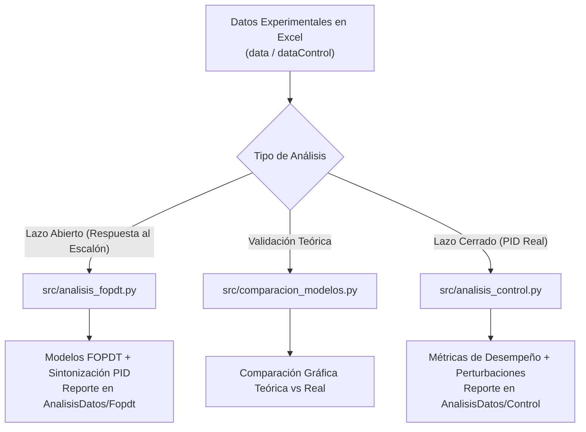

# Plataforma de Identificación y Control Térmico en Transistores BJT

Bienvenido al repositorio **ModelosBJT**. Este proyecto de tesis e investigación está diseñado para que estudiantes, ingenieros e investigadores puedan **identificar, comparar y validar estrategias de control automático** sobre una planta térmica experimental basada en transistores de potencia BJT.

---

## 🎯 ¿De qué trata este proyecto?

En electrónica de potencia y sistemas embebidos, la disipación térmica y el control preciso de temperatura son fundamentales. En este sistema:
1. **Actuador:** Uno o dos transistores BJT ($Q_1$ y $Q_2$) generan calor regulado mediante una señal PWM (0 a 100%).
2. **Sensor:** Sensores de temperatura miden en tiempo real la respuesta térmica del sistema en grados Celsius (°C), junto con el consumo de corriente eléctrica en miliamperios (mA).
3. **Objetivo:** 
   - Estimar modelos matemáticos precisos de la planta a partir de datos experimentales en lazo abierto (**FOPDT** y **Modelo Físico**).
   - Diseñar y sintonizar controladores PID (Ziegler-Nichols, IAE y Empírico).
   - Evaluar cuantitativamente el desempeño del control en lazo cerrado y su capacidad de rechazar perturbaciones térmicas externas.



---

## 📚 Fundamento Teórico Básico (Para Estudiantes)

### 1. Modelo FOPDT (Primer Orden Más Tiempo Muerto)
La mayoría de sistemas térmicos pueden representarse con gran exactitud mediante una función de transferencia de primer orden con retardo:

$$G(s) = \frac{K_p}{\tau s + 1} e^{-\theta s}$$

* **$K_p$ (Ganancia estática):** Cuánto sube la temperatura por cada unidad de PWM ($\Delta T / \Delta PWM$).
* **$\tau$ (Constante de tiempo):** Rapidez con la que reacciona el sistema (tiempo en alcanzar el 63.2% de su cambio total).
* **$\theta$ (Tiempo muerto / Retardo):** Tiempo que tarda el sensor en percibir el calor desde que se aplicó el PWM.

### 2. Modelo Físico Térmico
Basado en leyes de transferencia de calor por convección y radiación (Ley de Stefan-Boltzmann):
* Relaciona la masa del transistor ($m$), el área del disipador ($A$), la capacidad calorífica ($C_p$) y coeficientes de convección ($\alpha$, $h$).

### 3. Índices de Desempeño en Control
Para comparar qué controlador es mejor, se calculan índices numéricos objetivos:
* **$IAE$ (Integral del Error Absoluto):** $\int |e(t)| dt$. Mide el error total acumulado.
* **$ISE$ (Integral del Error al Cuadrado):** $\int e(t)^2 dt$. Penaliza con mayor severidad los errores grandes iniciales.
* **$ITAE$ (Integral del Error Ponderado en el Tiempo):** $\int t |e(t)| dt$. Penaliza los errores persistentes en estado estable.
* **$TV(u)$ (Variación Total de Control):** Mide la suavidad de la señal PWM. Un valor bajo evita desgastar los actuadores.

---

## 📂 Estructura del Repositorio

```text
ModelosBJT/
│
├── AnalisisDatos/              # Reportes finales generados automáticamente
│   ├── Control/                # Excels con métricas y gráficos de lazo cerrado
│   └── Fopdt/                  # Excels con modelos FOPDT y parámetros PID
│
├── data/                       # Datos experimentales en lazo abierto (escalones PWM)
│   ├── DatosGrafica_AdquirirQ1_*.xlsx
│   └── *.png                   # Gráficas de ensayos previos
│
├── dataControl/                # Datos de ensayos de control PID en lazo cerrado
│   ├── DatosGrafica_ControlQ1_*.xlsx       # Ensayos de 1 planta (Q1)
│   └── DatosGrafica_ControlQ1Q2_*.xlsx     # Ensayos de 2 plantas simultáneas (Q1 y Q2)
│
├── matlab/                     # Scripts y archivos de apoyo en MATLAB (.mlx)
│
├── src/                        # Código fuente en Python
│   ├── analisis_fopdt.py       # Identificación de sistemas FOPDT y sintonización PID
│   ├── analisis_control.py     # Análisis de desempeño temporal, error y perturbaciones
│   └── comparacion_modelos.py  # Ajuste de parámetros físicos frente a curvas reales
│
└── README.md                   # Documentación principal
```

---

## 🚀 Instalación y Requisitos

Requiere **Python 3.10** o superior. Instala las librerías necesarias con un solo comando:

```bash
pip install numpy pandas matplotlib control scipy openpyxl Pillow
```

---

## 🛠️ Guía de Uso Paso a Paso

### 1. Identificación del Sistema y Sintonización PID (`analisis_fopdt.py`)
Permite seleccionar interactivamente cualquier archivo de la carpeta `data/`:
```bash
python src/analisis_fopdt.py
```
**¿Qué hace el script?**
1. Recorta el escalón útil y calcula los parámetros FOPDT mediante dos métodos gráficos y el modelo físico térmico.
2. Analiza los rangos óptimos recomendados para el tiempo de muestreo ($T_s$).
3. Solicita por consola el tiempo de muestreo deseado y sintoniza automáticamente controladores **PID** usando reglas de **Ziegler-Nichols**, optimización **IAE** y ajuste **Empírico**.
4. **Exporta un reporte Excel completo** a `AnalisisDatos/Fopdt/` que incluye:
   - Tabla de parámetros de los modelos identificados.
   - Tabla de ganancias PID calculadas ($K_p$, $K_i$, $K_d$).
   - **La imagen del gráfico ($2\times 2$) incrustada directamente en la hoja de cálculo**.
5. Muestra las curvas interactivas comparando la planta real frente a los modelos simulados.

---

### 2. Evaluación de Ensayos de Control en Lazo Cerrado (`analisis_control.py`)
Permite evaluar ensayos reales de control guardados en la carpeta `dataControl/`:
```bash
python src/analisis_control.py
```
**¿Qué hace el script?**
1. **Detección automática de la configuración:** Acepta tanto archivos de **un solo transistor (`ControlQ1`)** como de **dos transistores simultáneos (`ControlQ1Q2`)**.
2. **Cálculo de métricas temporales:** Sobreimpulso ($OS\%$), tiempo de subida ($t_r$), tiempo de establecimiento al 2% y 5% ($t_s$), y error de régimen estacionario ($e_{ss}$).
3. **Cálculo de índices integrales y esfuerzo:** $IAE$, $ISE$, $ITAE$, PWM máximo/estacionario y variación total $TV(u)$.
4. **Análisis de perturbaciones térmicas:** Si durante la prueba se aplicó una perturbación (enfriamiento forzado), detecta automáticamente:
   - Momento del inicio de la caída de temperatura.
   - Temperatura mínima alcanzada (nadir) y caída total ($\Delta T$).
   - Reacción y saturación de la señal PWM.
   - Tiempo de recuperación al setpoint e $IAE$ exclusivo de la perturbación.
5. **Genera reporte Excel idéntico al formato de laboratorio** en `AnalisisDatos/Control/AnalisisControl_{fecha}.xlsx` con la imagen del gráfico de 4 paneles incrustada en la misma hoja.
6. Muestra las 4 gráficas interactivas: *Respuesta temporal vs SetPoint*, *Esfuerzo de control PWM*, *Señal de error* y *Consumo de corriente*.

---

### 3. Comparación Física Detallada (`comparacion_modelos.py`)
Para contrastar el modelo físico analítico frente a un ajuste de curvas experimental:
```bash
python src/comparacion_modelos.py
```
Permite ajustar constantes térmicas reales (área efectiva, emisividad, capacidad térmica) para calibrar el modelo teórico.

---

## 📊 Formato de los Reportes Excel Generados

Ambos scripts principales automatizan la generación de reportes listos para informes técnicos y artículos científicos:

| Elemento en la Hoja | Descripción |
| :--- | :--- |
| **Columna A** | Lista clara de variables analizadas (Setpoint, Sobreciclo, Tiempos, Índices $IAE/ISE/ITAE$, Corrientes). |
| **Columna B y C** | Valores numéricos nativos formateados para la Planta $Q_1$ (y Planta $Q_2$ si aplica). |
| **Columnas E a J (Superior)** | Tabla resumen con las ganancias configuradas en el controlador ($K_p$, $K_i$, $K_d$, $T_s$). |
| **Celda E5 / E6** | **Gráfico del proceso incrustado en alta resolución** alineado al lado de los datos. |

---

## 💡 Glosario Rápido para Estudiantes

* **¿Por qué importa el tiempo de muestreo ($T_s$)?**
  Si el tiempo de muestreo es muy lento, el controlador no reaccionará a tiempo y puede volverse inestable. Si es demasiado rápido, aumentará el costo computacional innecesariamente. La regla práctica sugiere elegir $T_s$ entre el 5% y 15% de $\tau$.
* **¿Qué significa que el IAE sea menor?**
  Significa que el controlador devolvió la temperatura a la referencia más rápido y con menos desviación acumulada.
* **¿Qué nos dice la Variación Total $TV(u)$?**
  Indica si la señal de control es ruidosa o agresiva. Un control que oscila bruscamente desgasta los componentes electrónicos y produce ruido electromagnético.

---

## 👥 Autoría y Licencia

Desarrollado como parte del proyecto de grado / tesis en Modelado y Control Automático de Sistemas Térmicos. Libre para fines académicos, educativos y de investigación.
