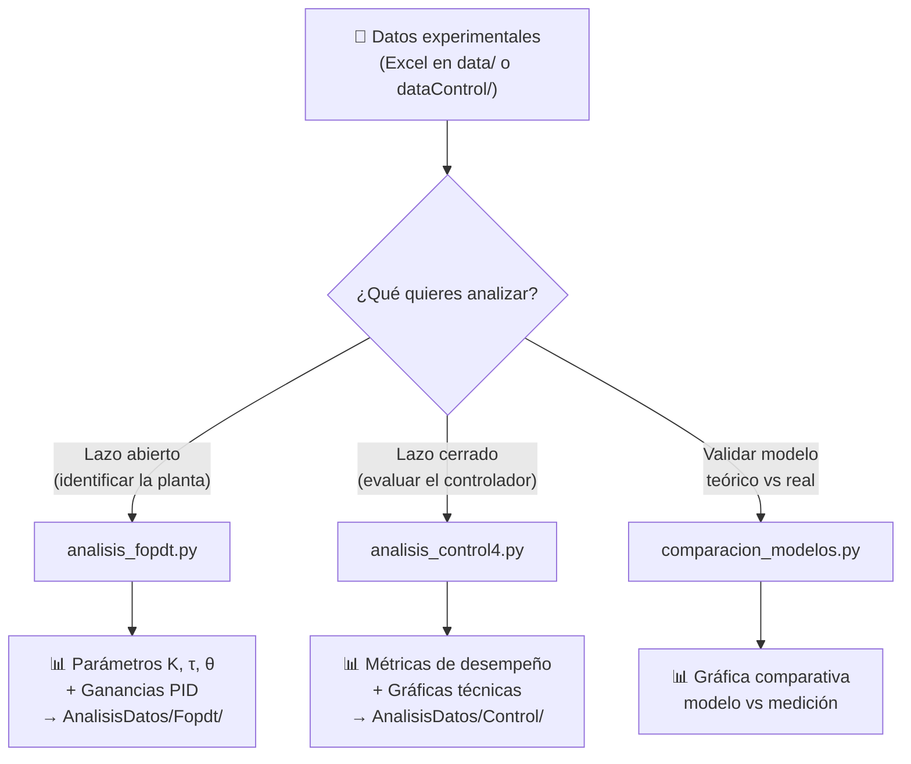

# 🌡️ ModelosBJT — Plataforma de Identificación y Control Térmico en Transistores BJT

> Proyecto académico e investigativo para **identificar, modelar y validar estrategias de control automático** sobre una planta térmica experimental construida con transistores de potencia BJT ($Q_1$ y $Q_2$).

---

## 📋 Tabla de Contenidos

1. [¿Qué es este proyecto?](#-qué-es-este-proyecto)
2. [¿Cómo funciona el sistema físico?](#-cómo-funciona-el-sistema-físico)
3. [Fundamentos Teóricos](#-fundamentos-teóricos)
4. [Estructura del Repositorio](#-estructura-del-repositorio)
5. [Instalación y Requisitos](#-instalación-y-requisitos)
6. [Guía de Uso Paso a Paso](#️-guía-de-uso-paso-a-paso)
7. [Formato de los Datos de Entrada](#-formato-de-los-datos-de-entrada)
8. [Reportes Excel Generados](#-reportes-excel-generados)
9. [Glosario para Estudiantes](#-glosario-para-estudiantes)

---

## 🎯 ¿Qué es este proyecto?

Este repositorio reúne herramientas en Python para analizar **sistemas de control de temperatura** basados en transistores BJT calentados por corriente eléctrica. Permite:

| Tarea | Herramienta | Resultado |
| :--- | :---: | :--- |
| Identificar el modelo matemático de la planta (lazo abierto) | `analisis_fopdt.py` | Parámetros FOPDT, ganancias PID calculadas |
| Evaluar la respuesta de un controlador PID (lazo cerrado) | `analisis_control4.py` | Métricas de desempeño, gráficas y reporte Excel |
| Contrastar modelo físico teórico vs. datos reales | `comparacion_modelos.py` | Gráfica comparativa superpuesta |

**¿Para quién es?** Estudiantes de ingeniería electrónica y de control, investigadores y docentes que trabajen con plantas térmicas experimentales.

---

## 🔌 ¿Cómo funciona el sistema físico?

```
   ┌──────────────┐    PWM (0–100%)    ┌───────────────────────┐
   │ Controlador  │ ─────────────────▶ │  Transistor BJT (Q1)  │ ──▶ Calor
   │     PID      │                    │  Transistor BJT (Q2)  │ ──▶ Calor
   │              │ ◀─────────────────  └───────────────────────┘
   └──────────────┘  Temperatura (°C)          │
                      Corriente (mA)    Sensor de temperatura
```

- **Actuador:** El transistor BJT disipa potencia eléctrica como calor. La señal de control es un PWM entre 0% y 100%.
- **Sensor:** Un termistor o sensor digital mide la temperatura en °C en tiempo real.
- **Objetivo del control:** Que la temperatura llegue y se mantenga en el valor de referencia (*SetPoint*) lo más rápido y suavemente posible, incluso ante perturbaciones externas (como aplicar un enfriamiento forzado).

---

## 📚 Fundamentos Teóricos

### Modelo FOPDT — Primer Orden con Tiempo Muerto

La mayoría de sistemas térmicos simples se comportan como:

$$G(s) = \frac{K_p}{\tau s + 1} \cdot e^{-\theta s}$$

| Parámetro | Símbolo | Significado físico |
| :--- | :---: | :--- |
| Ganancia estática | $K_p$ | °C de temperatura que sube por cada 1% de aumento en PWM |
| Constante de tiempo | $\tau$ | Tiempo que tarda el sistema en alcanzar el 63.2% de su cambio total |
| Tiempo muerto | $\theta$ | Retardo entre que se aplica el PWM y el sensor comienza a detectar cambio |

### Controlador PID

$$u(t) = K_p \, e(t) + K_i \int e(t)\,dt + K_d \frac{de(t)}{dt}$$

Donde $e(t) = SP - T(t)$ es el error entre la temperatura deseada y la medida.

### Métricas de Desempeño del Control

Una vez aplicado el controlador, se evalúa su calidad con estos indicadores:

| Métrica | Fórmula | ¿Qué mide? |
| :--- | :---: | :--- |
| Sobreimpulso $M_p$ | $(y_{max} - SP) / \Delta SP \times 100\%$ | Cuánto superó la temperatura al SetPoint |
| Tiempo de subida $t_r$ | $t_{90\%} - t_{10\%}$ | Rapidez para llegar al valor deseado |
| Tiempo de establecimiento $t_s$ | — | Cuánto tarda en entrar y mantenerse en la banda del 2% o 5% |
| Error estacionario $e_{ss}$ | $SP - y_{ss}$ | Error residual cuando el sistema se estabiliza |
| IAE | $\int \|e(t)\| \, dt$ | Error acumulado total |
| ISE | $\int e^2(t) \, dt$ | Penaliza más los errores grandes |
| ITAE | $\int t \cdot \|e(t)\| \, dt$ | Penaliza errores que persisten en el tiempo |
| TV(u) | $\sum \|u_{k+1} - u_k\|$ | Suavidad del PWM (menor = más suave) |

> **Nota sobre el sobreimpulso:** Este proyecto calcula **dos variantes** del sobreimpulso:
> - **Método 1** *(estándar de control)* — relativo al escalón: $M_{p,\Delta SP} = OS_{abs} / |\Delta SP|$
> - **Método 2** *(norma industrial)* — relativo al SetPoint: $M_{p,SP} = OS_{abs} / |SP|$
>
> En plantas térmicas, como $|SP| > |\Delta SP|$, el Método 2 siempre da un valor más pequeño. Ambos son correctos; depende del contexto en que se utilicen.

---

## 📂 Estructura del Repositorio

```text
ModelosBJT/
│
├── 📁 src/                              # Código fuente Python
│   ├── analisis_control4.py            # ⭐ Análisis principal de lazo cerrado (versión actual)
│   ├── analisis_fopdt.py               # Identificación FOPDT y sintonización PID
│   └── comparacion_modelos.py          # Comparación modelo físico vs. datos reales
│
├── 📁 dataControl/                      # Datos de ensayos en lazo CERRADO (con controlador)
│   ├── DatosGrafica_ControlQ1_*.xlsx   # Ensayo de 1 transistor
│   └── DatosGrafica_ControlQ1Q2_*.xlsx # Ensayo simultáneo de 2 transistores
│
├── 📁 data/                             # Datos de ensayos en lazo ABIERTO (escalón de PWM)
│   └── DatosGrafica_AdquirirQ1_*.xlsx
│
├── 📁 AnalisisDatos/                    # Reportes generados automáticamente ← no editar
│   ├── Control/                         # Resultados de analisis_control4.py
│   └── Fopdt/                           # Resultados de analisis_fopdt.py
│
├── 📁 matlab/                           # Scripts de apoyo en MATLAB (.mlx)
│
├── CAMBIOS_ANALISIS_CONTROL4.md        # Documentación técnica del módulo de control
└── README.md                           # Este archivo
```

---

## 🚀 Instalación y Requisitos

### Requisitos

- **Python 3.10** o superior
- Las siguientes librerías (todas instalables con `pip`)

```bash
pip install numpy pandas matplotlib scipy openpyxl Pillow
```

### Verificar que todo funciona

```bash
python -c "import numpy, pandas, matplotlib, openpyxl; print('✅ Todo instalado correctamente')"
```

### Clonar el repositorio

```bash
git clone <url-del-repositorio>
cd ModelosBJT
```

---

## 🛠️ Guía de Uso Paso a Paso

### Flujo general del proyecto



---

### Paso 1 — Identificar la planta (`analisis_fopdt.py`)

Usa los datos de **lazo abierto** (carpeta `data/`) para estimar el modelo matemático de la planta.

```bash
python src/analisis_fopdt.py
```

El script te pedirá que elijas un archivo y luego hará automáticamente:

1. Detecta el escalón de PWM y recorta la región útil de la señal.
2. Estima los parámetros **FOPDT** ($K_p$, $\tau$, $\theta$) por tres métodos:
   - Método gráfico de Smith
   - Ajuste por mínimos cuadrados (*curve fitting*)
   - Modelo físico térmico (convección + radiación)
3. Recomienda el rango óptimo para el tiempo de muestreo $T_s$.
4. Te pide ingresar $T_s$ y calcula los parámetros PID por tres reglas:
   - **Ziegler-Nichols** (agresivo, decaimiento 1/4)
   - **Criterio IAE** (mínimo error acumulado)
   - **Empírico** (ajuste conservador)
5. Exporta un reporte Excel a `AnalisisDatos/Fopdt/` con tablas y gráficas incrustadas.
6. Muestra gráficas interactivas de la planta real vs. modelos estimados.

**Formato del archivo de entrada esperado (`data/*.xlsx`):**

| Columna | Nombre | Descripción |
| :---: | :---: | :--- |
| A | `Tiempo` | Tiempo en segundos |
| B | `Temperatura` | Temperatura medida en °C |
| C | `Corriente` | Corriente en mA (opcional) |
| D | `PWM` | Ciclo de trabajo en % (0–100) |

---

### Paso 2 — Evaluar el controlador (`analisis_control4.py`) ⭐

Usa los datos de **lazo cerrado** (carpeta `dataControl/`) para evaluar el desempeño del controlador PID.

```bash
# Modo interactivo (te muestra un menú para elegir archivo)
python src/analisis_control4.py

# Modo directo (pasar el archivo como argumento)
python src/analisis_control4.py dataControl/DatosGrafica_ControlQ1Q2_20261029_170145.xlsx
```

El script realiza automáticamente:

1. **Limpieza y remuestreo** de los datos a una malla temporal uniforme de 1 segundo.
2. **Detección del escalón de SetPoint** y descarte de pulsos espurios (*glitches*).
3. **Cálculo de métricas de respuesta transitoria:**
   - Sobreimpulso por dos métodos (relativo al escalón y al SetPoint)
   - Tiempo de subida $t_r$, tiempo de pico $t_p$, tiempos de establecimiento $t_{s,2\%}$ y $t_{s,5\%}$
   - Error en estado estacionario $e_{ss}$
4. **Clasificación automática del comportamiento dinámico:**
   - Sobreamortiguado (sin sobreimpulso)
   - Subamortiguado Cuasi-crítico / Óptimo
   - Subamortiguado Moderado
   - Subamortiguado Pronunciado
   - Altamente Oscilatorio / Crítico
5. **Detección de perturbaciones externas** (enfriamiento o calentamiento forzado), reportando caída de temperatura, reacción del PWM y tiempo de recuperación.
6. **Reporte en consola** con tabla comparativa entre $Q_1$ y $Q_2$.
7. **Exportación a Excel** con 5 hojas técnicas y gráficas incrustadas.
8. **Figuras interactivas** con 4 paneles.

**Ejemplo de salida en consola:**

```
[2] FASE DE RESPONSIVA AL ESCALÓN:
Métrica                              | Q1               | Q2
--------------------------------------------------------------------------
SetPoint Objetivo [°C]               | 50.00            | 50.00
Magnitud del Escalón ΔSP [°C]        | 13.00            | 14.00
  -> MÉTODO 1: OS (% de ΔSP)         | 11.54 %          | 10.71 %
  -> MÉTODO 2: OS (% de SP)          | 3.00 %           | 3.00 %
Comportamiento Transitorio           | MODERATE_UNDERDAMPED
Factor Amortiguamiento Est. (ζ)      | 0.566            | 0.579
Tiempo de Subida tr (10-90%) [s]     | 41.0             | 40.0
Tiempo de Establ. ts (5%) [s]        | 185.0            | 125.0
```

**Formato del archivo de entrada esperado (`dataControl/*.xlsx`):**

Para ensayo de **un transistor** (`ControlQ1_*.xlsx`):

| Columna | Nombre | Descripción |
| :---: | :---: | :--- |
| A | `Tiempo` | Tiempo en segundos |
| B | `Temperatura1` | Temperatura de Q1 en °C |
| C | `Corriente1` | Corriente en mA |
| D | `PWM1` | Ciclo de trabajo en % |
| E | `SetPoint` | Temperatura de referencia en °C |

Para ensayo de **dos transistores** (`ControlQ1Q2_*.xlsx`), se agregan las columnas:

| Columna | Nombre | Descripción |
| :---: | :---: | :--- |
| F | `Temperatura2` | Temperatura de Q2 en °C |
| G | `Corriente2` | Corriente de Q2 en mA |
| H | `PWM2` | Ciclo de trabajo de Q2 en % |
| I | `SetPoint2` | Referencia de Q2 en °C |

Opcionalmente, el archivo puede incluir las ganancias PID usadas (columnas `Kp`, `Ki`, `Kd`, `Ts`, `Planta`) para que aparezcan en el reporte.

---

### Paso 3 — Comparar modelo físico (`comparacion_modelos.py`)

Permite calibrar el modelo físico térmico (basado en convección y radiación de Stefan-Boltzmann) ajustando sus parámetros a los datos reales.

```bash
python src/comparacion_modelos.py
```

> **Nota:** Este script requiere editar manualmente la ruta del archivo y el tiempo muerto $\theta$ directamente en el código (variables `PATH_DOCUMENTO` y `THETA_FIS` al inicio del archivo).

---

## 📊 Reportes Excel Generados

`analisis_control4.py` genera un libro Excel en `AnalisisDatos/Control/` con 5 hojas:

| Hoja | Contenido |
| :--- | :--- |
| **ResumenControl** | Tabla ejecutiva comparando Q1 y Q2, parámetros PID y gráfica 2×2 incrustada |
| **Perturbaciones** | Tabla con métricas de cada perturbación detectada (caída, recuperación, IAE) |
| **ParametrosPID** | Ganancias $K_p$, $K_i$, $K_d$, $T_s$ leídas del archivo de datos |
| **DatosSegmentados** | Malla uniforme completa con etiqueta de fase por cada muestra |
| **Graficas** | Figura de zoom por fase (Escalón + cada Perturbación) |

Las filas de **Sobreimpulso Método 1 y Método 2** están resaltadas en amarillo para facilitar su comparación.

---

## 💡 Glosario para Estudiantes

<details>
<summary><b>¿Por qué hay dos métodos de sobreimpulso y cuál uso?</b></summary>

Depende del contexto:
- Si comparas **controladores entre sí** o calculas el factor de amortiguamiento ζ → usa **Método 1** (relativo al escalón ΔSP). Es el estándar de los libros de control automático.
- Si verificas una **especificación de seguridad** tipo "la temperatura no debe superar en más del 3% el SetPoint fijado" → usa **Método 2** (relativo al SetPoint SP).

Como en plantas térmicas la temperatura inicial (ej. 37 °C) ya es mayor a cero, el Método 2 siempre da un número más chico. Ambos son válidos y complementarios.

</details>

<details>
<summary><b>¿Qué significa ζ (factor de amortiguamiento)?</b></summary>

Describe qué tan oscilatoria es la respuesta:

| Valor de ζ | Comportamiento | Visual |
| :---: | :--- | :--- |
| ζ ≥ 1.0 | Sin oscilación — llega suavemente al SetPoint | Curva sin pico |
| ζ ≈ 0.7 | Óptimo — llega rápido con sobreimpulso mínimo (<5%) | Pequeño pico y se asienta |
| ζ ≈ 0.5 | Moderado — sobreimpulso notable pero manejable (5–15%) | Pico visible |
| ζ < 0.35 | Oscilatorio — rebota varias veces antes de estabilizarse | Varias oscilaciones |

</details>

<details>
<summary><b>¿Por qué el tiempo de muestreo Ts importa tanto?</b></summary>

Si $T_s$ es muy grande (lento), el controlador no ve los cambios de temperatura a tiempo y puede oscilar o volverse inestable. Si es muy pequeño (rápido), gasta recursos de cómputo innecesariamente y puede amplificar ruido.

La regla práctica: elegir $T_s$ entre el **5% y el 15% de la constante de tiempo τ** de la planta.

</details>

<details>
<summary><b>¿Qué significa que el IAE sea menor?</b></summary>

Que el controlador redujo el error más rápido y con menos desviación acumulada. Al comparar dos controladores con los mismos datos, el que tenga menor IAE fue más eficiente para corregir el error a lo largo del tiempo.

</details>

<details>
<summary><b>¿Qué es la Variación Total TV(u) y por qué importa?</b></summary>

Mide cuánto "se mueve" la señal PWM. Un TV(u) alto significa que el actuador está oscilando bruscamente entre valores altos y bajos, lo que:
- Genera calor extra en el transistor BJT
- Produce ruido electromagnético
- Desgasta los componentes

Un buen controlador tiene TV(u) bajo sin sacrificar el tiempo de establecimiento.

</details>

---

## 👥 Autoría y Licencia

Desarrollado como proyecto de grado / tesis en **Modelado y Control Automático de Sistemas Térmicos**.  
Libre para uso académico, educativo y de investigación.

---

*¿Tienes dudas o encontraste un error? Revisa la documentación técnica detallada en [`CAMBIOS_ANALISIS_CONTROL4.md`](CAMBIOS_ANALISIS_CONTROL4.md).*
